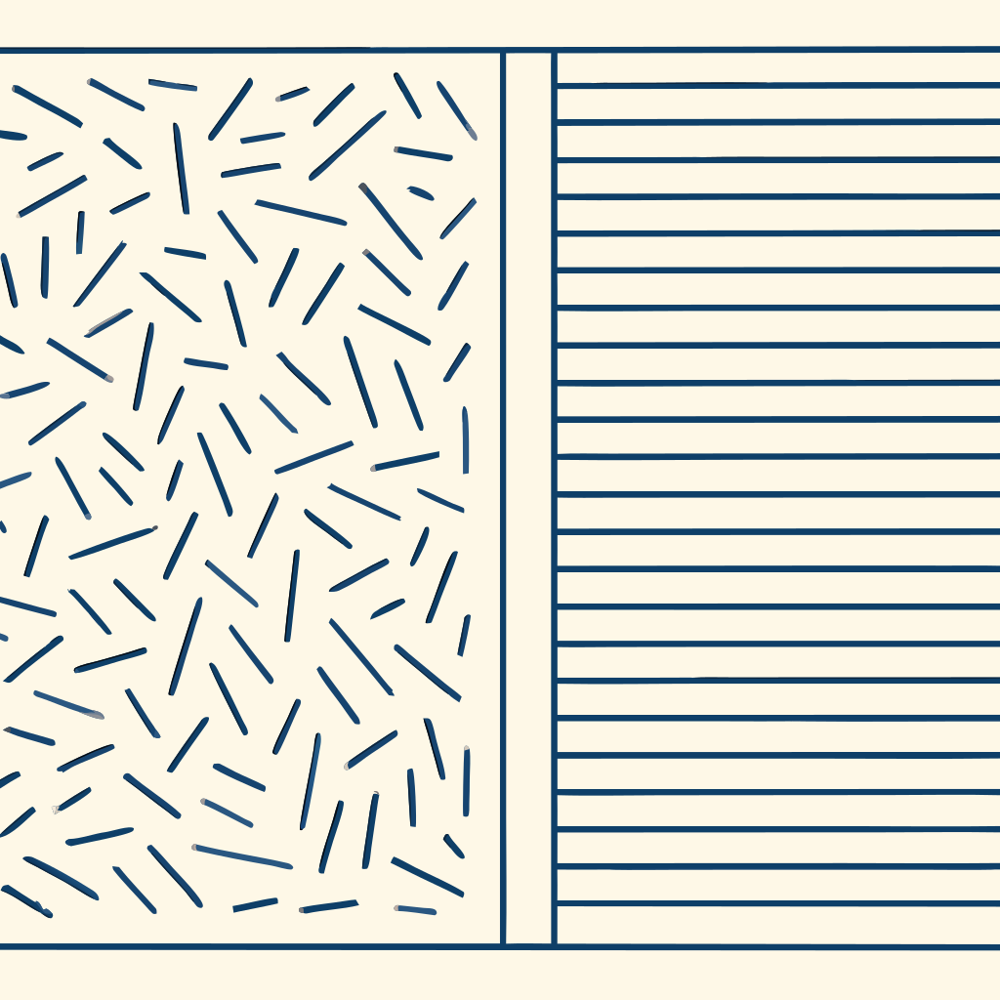
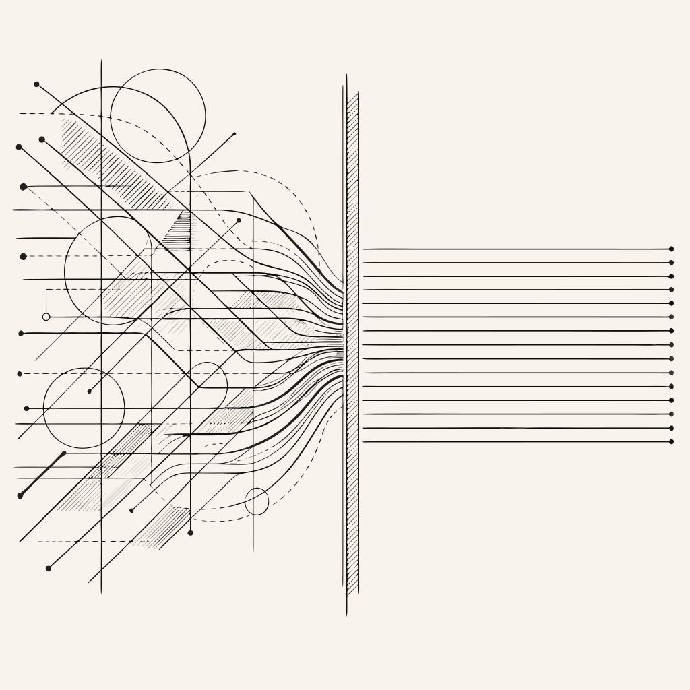

# ADR 026 — Cover Illustration Generation: Hand-Authored Compass Grammar vs. AI-Generated Content-Layer Specimens

**Date:** 2026-09-28
**Status:** Superseded by [ADR 027](./027-cover-illustration-content-layer-ai-generated-specimens-hand-authored-infrastructure-boundary.md) (2026-10-10). The `/impeccable` design-critique session this ADR called for has run; ADR 027 records the resolution (a two-layer Infrastructure/Content design system, adopting AI-generated specimens for cover art under a narrower Content-layer ruleset). This ADR's fork and PoC evidence remain the historical record of how that decision was reached — do not treat the options below as still open.

## Context

`.docs/tasks/2026-09-27-project-image-generation.md` scopes cover illustrations for `/projects/[slug]`'s `SpecimenIllustration` component (`media.cover`). That task's first pass reached for AI raster generation (OpenAI `gpt-image-2`) and reversed course the same day: DESIGN.md's Compass Grammar, Flat-by-Construction, and No-Decoration rules require hand-verifiable straight lines and true arcs, a strict two-tone cream/graphite palette (`#f8f4ed` / `#2a2a2a`), and zero gradients — properties no raster-then-vectorize pipeline can guarantee. The task pivoted to hand-authored SVG. Two projects (hivemq-edge, demist) now have three grounded candidate briefs each at `.docs/design/covers/{hivemq-edge,demist}/briefs.md`, with hand-authored SVGs staged (not yet promoted). **That work is the accepted baseline and is unaffected by this ADR.**

On 2026-09-28, Nicolas installed the `svgmaker` MCP (a hosted AI-image-generate-then-auto-vectorize service, backed by Recraft at the tested quality tier) and asked for a proof-of-concept run against hivemq-edge specifically to re-test the raster-AI path — not to abandon the hand-authored baseline, but to see whether a better tool changes the 2026-09-27 conclusion. Free-tier credits (6 total) were spent entirely on this PoC.

### Proof-of-concept evidence

Two prompting strategies were tested, holding style parameters constant (`style=line_art`, `color_mode=few_colors`, `background=opaque`, `composition=full_scene`, `image_complexity=illustration`, `aspectRatio=square`):

| Run        | Prompting strategy                                                                                                                                                                                                                                       | Result file                                                              | Colors                                                                               | Gradients           | Paths                   |
| ---------- | -------------------------------------------------------------------------------------------------------------------------------------------------------------------------------------------------------------------------------------------------------- | ------------------------------------------------------------------------ | ------------------------------------------------------------------------------------ | ------------------- | ----------------------- |
| A          | **Dictated construction** — prompt translated the hand-authored brief's own Composition section almost verbatim (exact hatched-field/aperture/band geometry) into prose                                                                                  | `.docs/design/covers/hivemq-edge/svgmaker-poc-dictated-construction.svg` | 6+, including navy blues                                                             | 3 `linearGradient`  | 273 traced bezier paths |
| B          | **Story-driven** — prompt gave the raw narrative/source-grounding text (HiveMQ Edge translates 20+ industrial OT protocols into MQTT for non-developer factory workers) plus domain context, and explicitly told the model to invent its own composition | `.docs/design/covers/hivemq-edge/svgmaker-poc-story-driven.svg`          | clean cream→graphite grey ramp (`rgb(249,242,222)` → `rgb(15,15,13)`), no stray hues | 62 `linearGradient` | 337 traced bezier paths |
| B (repeat) | Story-driven, applied to DEMIST (time-representation taxonomy, "pop-up bias" default-steering finding, asymmetric DeFT framework as the story input)                                                                                                     | `.docs/design/covers/demist/svgmaker-poc-story-driven.svg`               | same clean grey-ramp pattern                                                         | 20 `linearGradient` | 234 traced bezier paths |

**Consistent finding:** story-driven prompting reliably produces a disciplined, on-palette _hue_ — no wandering into blues/browns — which is a real, repeatable creative-quality win over dictating geometry directly. But neither strategy eliminates gradients or organic traced-bezier construction, in any run. This is a property of the underlying pipeline (paint a raster image, then auto-vectorize it), not of prompt wording — the service's own documentation confirms this (see "SVGMaker platform research" below). Structurally, none of the three outputs satisfy DESIGN.md's hand-verifiable straight-line/true-arc, zero-gradient requirement.

Nicolas's own read of the results: both svgmaker outputs look like "sketches," not ruler-and-compass constructions — which reframes the question this ADR exists to capture (see Decision).

**Featured examples** (the two Nicolas asked to be included, per his preference for the "construction" axis — Run A, dictated-construction — alongside Run B for direct comparison; paths are relative to this file, resolve in an editor/local markdown preview, not guaranteed to resolve through the site's asset pipeline since `.docs/` isn't under `public/`):

_Run A — "Twenty-Plus, One" geometry dictated almost verbatim from the hand-authored brief. Navy-blue palette, 3 gradients, 273 traced paths._

_Run B — same project, story-driven prompt instead. Clean cream-to-graphite grey ramp, but 62 gradients, 337 traced paths._

### SVGMaker platform research (2026-09-28)

Fetched from `svgmaker.io/docs` during this session, relevant to what to try next if the AI-generation path is pursued further:

- The vendor's own tip for technical diagrams: combine **Line Art** style with **Monochrome** color mode (not `few_colors`, which both PoC runs used), Icon/Illustration complexity, and **Transparent** background (both PoC runs used `opaque`) — both PoC runs diverge from the vendor's own recommendation on two of four axes.
- The API supports a `model` parameter (mutually exclusive with `quality`) to select a specific underlying model directly. The model-comparison page names **GPT Image 1.5 Pro / 1 Pro / 1 Mini**, **Z-Image Turbo**, and **Qwen Image** as vector-friendly, clean-vectorization models — versus **FLUX**, **Imagen**, **Seedream**, **Nano Banana Pro** as painterly/gradient-heavy and explicitly harder to vectorize cleanly. Recraft (what was actually used, via `quality`-tier routing) isn't in either named list.
- **The currently-installed `svgmaker` MCP tool's exposed schema (`mcp__svgmaker__svgmaker_generate` / `_edit`) does not expose a `model` parameter at all** — only `quality` (low/medium/high). Model selection, the single most likely lever to fix the gradient/organic-path problem, is not reachable through this MCP tool as wired; it would require a direct API call bypassing the MCP, or an upstream change to the tool's exposed schema.
- The `svgmaker_edit` endpoint (takes an existing generation and a further text instruction) documents support for "convert to monochrome or limited color palettes," "simplify the design and reduce complexity," and applying a different Visual Style. **Not empirically tested this session** — free-tier credits were exhausted before this could be tried. Plausible as a post-hoc cleanup pass, unverified.

### An existing mechanism this PoC surfaced

`SpecimenIllustration.tsx` already applies a `duotone-specimen` CSS utility (`src/styles/utilities/index.css:207-213`, `filter: grayscale(100%) sepia(20%) contrast(1.1)`) to any `media.cover` image. The utility's own code comment states it is explicitly "a bridge for imported photography, not a default" for images not already authored within the visual world — hand-authored SVGs skip it by design, since they're natively in-world. This mechanism is wired and live but currently unused by anything, because nothing non-native has ever been set as a `media.cover` value.

## Decision

**This ADR does not decide between the two options below.** It records the fork precisely enough for an `/impeccable` session to adjudicate, per Nicolas's direct request. What follows is Nicolas's own framing, captured verbatim in intent: rather than treating the svgmaker PoC as a clean failure against the Compass Grammar, is there a principled split where AI-generated "sketch" illustrations deliberately represent the portfolio's **content** (each project's own subject matter — organic, observed, specimen-like), as opposed to the portfolio's **structure** (site chrome — rigorously compass-and-ruler), with the existing `duotone-specimen` filter as the visual "transition toward" the structural world at the boundary? The component's own name — "Specimen Illustration" — and DESIGN.md's Overview framing ("The visual world is a geometric proof in progress... construction-in-progress metaphor") both support reading a project's cover as a collected/observed specimen _mounted onto_ the construction world, rather than itself required to be compass-and-ruler.

### Option 1 — Hand-authored only (status quo, 2026-09-27 pivot stands)

Every cover illustration, for every project, is hand-authored flat SVG per the existing pipeline in `.docs/tasks/2026-09-27-project-image-generation.md`: compass-and-ruler construction, strict two-tone palette, zero gradients, `<g id="base">`/`<g id="layer-...">` structure for evolvable candidates. No AI generation anywhere in the cover pipeline.

**Pros:**

- Token-exact color, zero drift risk — no AI reinterpretation of "cream" or "graphite."
- Zero cost, no external dependency, no API key, no credit budget to manage.
- Structurally guarantees DESIGN.md compliance — "no gradients" is enforced by what primitives exist in the file, not by a prompt instruction that can be ignored.
- One visual grammar across the entire site — no second illustration language to maintain or explain.
- Every mark is traceable to a quoted source sentence (Phase 2's grounding discipline) — an audit trail AI generation cannot produce.

**Cons:**

- Slow: full six-phase pipeline (brief → written interpretation → author+preview → review → promote → record) per project, entirely by hand.
- Doesn't scale gracefully to every project in `src/content/{research,engineering}/` — the two generic fallbacks exist precisely because bespoke authorship isn't always justified.
- Caps visual richness at what's expressible in stroke-based primitives; DESIGN.md's own "shallow fold" gradient exception shows even the structural world admits rare, deliberate departures — a pure hand-authored approach forecloses any analogous move for cover art.

### Option 2 — Hybrid: AI-generated content-layer specimens, hand-authored structure

Introduce a second, deliberately distinct illustration register for cover art specifically: AI-generated (via svgmaker or similar), routed through the existing `duotone-specimen` filter as the literal content→structure bridge, while all structural chrome (nav, headers, status stamps, dimension lines, everything DESIGN.md's Compass Grammar governs directly) stays hand-authored and untouched by this option.

**Pros:**

- Story-driven prompting (Approach B above) is fast and produces genuinely on-brief creative composition — an hour of iteration vs. a multi-phase hand-authored pipeline per candidate.
- Scales to every project without per-project hand-authorship being the bottleneck.
- Gives the "content vs. structure" visual distinction Nicolas is proposing a real, load-bearing job: covers stop being flat compass diagrams and start reading as specimens — arguably a stronger fit for "Specimen Illustration" as a name than a construction diagram is.
- The bridging mechanism (`duotone-specimen`) already exists, is already tested (CT spec asserts the class is applied), and needs no new code to try.

**Cons:**

- **Not free**: svgmaker is credit-metered even on generous tiers; a full-portfolio rollout has a real, recurring cost the current approach doesn't.
- Introduces a second illustration grammar to explain and maintain — a future contributor (or agent) has to learn "which projects get which treatment," and the rule for that split isn't yet designed.
- The `duotone-specimen` filter (`grayscale(100%) sepia(20%) contrast(1.1)`) has never been visually verified against real AI-generated output — it was written for photography, and whether it satisfactorily tames gradient-heavy, multi-hue AI output (vs. flattening it into mud, or leaving objectionable tonal gradients merely greyscale-shifted rather than removed) is untested. A gradient survives a grayscale/sepia filter as a _grayscale_ gradient — the filter changes hue, not the presence of gradients. Whether that reads as acceptable "specimen" texture or as still-visible rule-breaking is a real open design question, not a solved one.
- Does not by itself resolve the "which model/settings actually work" problem — see the open technical questions above (`model` param not exposed by the MCP, `svgmaker_edit` untested). Adopting this option doesn't mean the pipeline is ready; it means committing to solve those before it is.
- Risks diluting the "geometric proof, nothing arbitrary" credibility DESIGN.md's Overview explicitly claims as the point of the whole visual system, if the content/structure split isn't drawn crisply.

### What would resolve this

An `/impeccable` design-critique session, explicitly requested by Nicolas, using this ADR plus the example images below as the starting material. Candidate questions for that session: does a content/structure split read as intentional or as inconsistency to a first-time visitor; does `duotone-specimen` need retuning (or a new dedicated filter) once real AI output is tested against it; if adopted, which projects get AI-generated vs. hand-authored covers and by what rule (all covers, or only ones without sufficient narrative content — inverting the current generic-fallback logic); should Option 2 apply to `media.cover` only, or could it extend to other imagery slots later (non-goal for this ADR either way — not decided here).

## Consequences

**If Option 1 stands (no change):**

- Good: nothing above changes any code or process; the 2026-09-27 pipeline continues exactly as documented.
- Bad: the "content vs. structure" idea goes untested, and the `duotone-specimen` bridge remains permanently unused unless some other imagery need arises.

**If Option 2 is adopted (future ADR, not this one):**

- Good: cover-art velocity increases sharply; the specimen framing gets a real design job to do.
- Bad: recurring API cost enters the project for the first time in its cover-art pipeline; a second illustration grammar needs its own documented rule (which this ADR does not attempt to write).

**Either way:**

- The svgmaker PoC SVGs (`.docs/design/covers/{hivemq-edge,demist,calques3d,ilp,leactivemath,auditorygames}/svgmaker-poc-*.svg`) stay on disk as committed evidence — not promoted to `public/images/covers/`, not deleted. They inform the `/impeccable` session and any future ADR that supersedes this one. Each project directory also has a `svgmaker-prompts.md` recording the exact prompt(s) used — see Related.
- Four more projects were run through the story-driven approach after this ADR's initial draft — calques3d (2026-09-29), ILP (2026-09-30), LeActiveMath (2026-10-01), Auditory Games (2026-10-06) — each using the free tier's 3-credits-per-day refresh (one generation ≈ 2 credits, so roughly one run/day, not always consecutive). This has become an open-ended rolling set rather than a fixed PoC batch — more projects may be added the same way before the `/impeccable` session happens. Across all six projects now on record, gradient count and path density vary a lot (0–62 gradients, 135–1608 paths) but the cream-to-graphite grey-ramp palette discipline is consistent every single time — zero runs wandered back into stray hues once the story-driven approach replaced dictated-construction. ILP's result remains the cleanest of any run — zero gradients, zero `<defs>`, only 7 colors dominated by an even cream/near-black split — plausibly because its subject matter (asymmetric evidence, hidden logical structure) is more abstract and has fewer "photographable" objects than the others. This is a live data point for the `/impeccable` session: subject abstraction level may correlate with how close story-driven output lands to the flat-construction target, independent of any prompt-wording change.
- The two open technical questions (MCP `model` param not exposed; `svgmaker_edit` untested) remain open regardless of which option is chosen, if any further svgmaker work happens at all.

## Alternatives considered

**Pure AI raster generation via OpenAI `gpt-image-2`** (the 2026-09-27 task's original first pass) — rejected before this ADR existed, for the same structural reasons Option 1's pros restate (no token-exact color, no gradient guarantee, real per-image cost, required an API key not available in that environment). Superseded by the hand-authored pivot; this ADR's Option 2 is a different proposal (a deliberately-scoped content-layer use, not a wholesale replacement) and does not reopen that original rejection.

**Dictated-construction prompting as the AI strategy, if Option 2 is ever adopted** — tested this session (Approach A above), rejected as the better of the two AI prompting strategies: it produced worse color discipline (wandered into navy blues) than story-driven prompting, for no compensating gain in structural compliance (still gradient-heavy, still traced paths either way). If Option 2 proceeds, story-driven prompting is the stronger starting point of the two tested.

**Do nothing / decide now without an `/impeccable` session** — rejected per explicit instruction: Nicolas asked for this exact fork to be recorded and handed to a design-critique session, not resolved inline by the agent that ran the PoC.

## Related

- `.docs/tasks/2026-09-27-project-image-generation.md` — the hand-authored pipeline this ADR's Option 1 continues and Option 2 would partially bypass.
- `.docs/design/covers/hivemq-edge/briefs.md`, `.docs/design/covers/demist/briefs.md` — the accepted hand-authored candidate briefs, unaffected by this ADR.
- `.docs/design/covers/hivemq-edge/svgmaker-poc-dictated-construction.svg`, `.docs/design/covers/hivemq-edge/svgmaker-poc-story-driven.svg`, `.docs/design/covers/demist/svgmaker-poc-story-driven.svg`, `.docs/design/covers/calques3d/svgmaker-poc-story-driven.svg`, `.docs/design/covers/ilp/svgmaker-poc-story-driven.svg`, `.docs/design/covers/leactivemath/svgmaker-poc-story-driven.svg`, `.docs/design/covers/auditorygames/svgmaker-poc-story-driven.svg` — the PoC evidence this ADR is built on.
- `.docs/design/covers/{hivemq-edge,demist,calques3d,ilp,leactivemath,auditorygames}/svgmaker-prompts.md` — the exact prompt text and style parameters behind each generated image above, one file per project. `hivemq-edge`'s file has both the dictated-construction and story-driven prompts side by side, for direct comparison.
- `src/app/projects/[slug]/_components/SpecimenIllustration.tsx` — the component this decision ultimately governs.
- `src/styles/utilities/index.css:207-213` — the `duotone-specimen` utility central to Option 2.
- `DESIGN.md` — Compass Grammar, One Red Rule, No-Decoration Rule, Flat-by-Construction Rule (Named Rules, Elevation & Depth, Shapes sections); Overview's "Construction on Tracing Paper" north star, which both options above argue from.
- ADR 004 — Component conventions (governs any future `SpecimenIllustration.tsx` changes).

## More Information

- **2026-09-28:** PoC run and this ADR both produced in one session, following direct instruction from Nicolas after reviewing the svgmaker outputs live. Free-tier svgmaker credits (6) fully spent on the PoC; no further generation possible until the account's credits refresh or a paid tier is added.
- **2026-09-29 through 2026-10-06:** four more projects run through the story-driven approach on the free tier's daily 3-credit refresh (calques3d, ILP, LeActiveMath, Auditory Games) — see the updated Consequences note above. Prompt text for every run, across all six projects on record so far, is recorded in each project's `svgmaker-prompts.md` (added retroactively after Nicolas asked whether the prompts had been saved anywhere — they had not been, until this note). This set is being extended on an ongoing basis as credits allow, not closed to a fixed batch — check `.docs/design/covers/` directly for the current full list before assuming this note is exhaustive.
- Revisit this ADR (by writing a new one that supersedes it, per ADR 017's lifecycle) once the `/impeccable` session referenced above has actually run — this document should not sit as `proposed` indefinitely.
